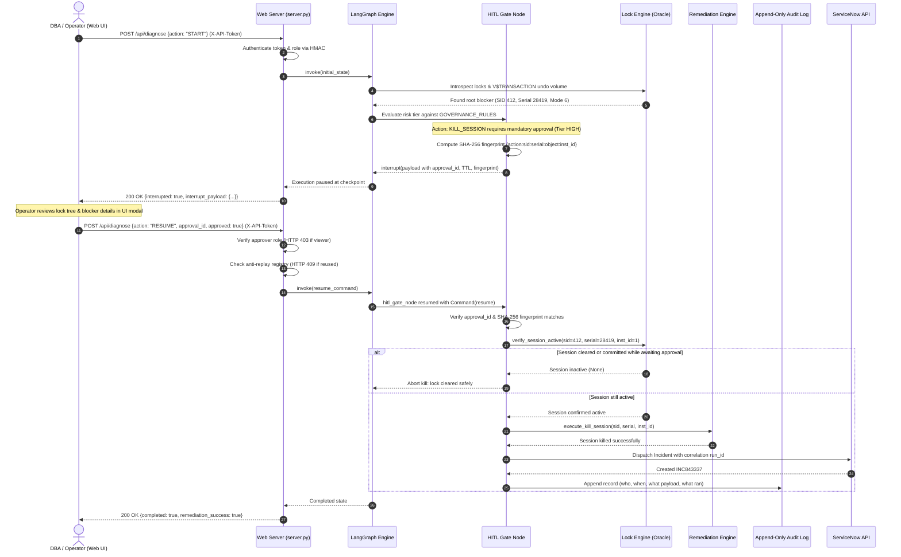

# 🚀 Autonomous ASCP Collections Diagnostic Agent
### Oracle E-Business Suite (EBS) & Advanced Supply Chain Planning (ASCP) Control Panel

[](https://www.python.org/)
[](LICENSE)
[](https://langchain-ai.github.io/langgraph/)
[](https://github.com/logpai/logparser)
[-brightgreen.svg)](tests/)
[](https://github.com/tripathiswastik)

An autonomous, stateful diagnostic control plane built to triage, diagnose, and remediate Oracle ASCP batch collection pipeline failures across dual-stage ETL architectures. Powered by **LangGraph**, **Drain algorithmic log parsing**, and **Oracle dynamic performance view lock introspection**.

> **Note on Deployment Model:** This agent is designed **simulation-first for safe evaluation**, but contains fully hardened live adapter paths for Oracle Database (with RAC support), PostgreSQL state checkpointing, and ServiceNow ITSM. Live database errors fail closed loudly rather than being masked as simulations.

---

## 🌟 Key Capabilities

1. **Dual-Stage ETL Pipeline Monitoring & Registry Tracking**
   - Monitors execution progression across **Source ADS** &rarr; **Snapshot Logs (`MLOG$_`)** &rarr; **Stage 1 Staging (`MSC_ST_*`)** &rarr; **Stage 2 ODS (`MSC_*`, `plan_id = -1`)** &rarr; **Stage 3 PDS (`plan_id > 0`)**.
   - Tracks `MSC_APPS_INSTANCES.ST_STATUS` (0 = IDLE, 1 = PULL_PROCESSING, 2 = LOAD_PROCESSING, 3 = PURGE_PROCESSING, -1 = ERROR_STALLED).

2. **Real-Time Hierarchical Oracle Lock Engine & Connection Pooling**
   - Enterprise connection pooling via `python-oracledb` thin mode with automatic simulation fallback.
   - Interrogates `V$SESSION`, `V$LOCK`, `V$LOCKED_OBJECT`, `DBA_OBJECTS`, and `V$SQL` using recursive `CONNECT BY PRIOR s.sid = s.blocking_session` queries.
   - Maps enqueue lock modes 0 through 6 (`LOCKED_MODE = 6` Exclusive locks blocking `MSC_ST_*` staging truncations and worker writes).
   - Live query of `V$TRANSACTION` / `GV$TRANSACTION` via `s.taddr` using bind variables to assess uncommitted rollback volume before termination.

3. **Drain Fixed-Depth Parse Tree Engine**
   - Rapidly tokenizes high-velocity unstructured concurrent request logs into structured templates and parameter vectors (`<TIMESTAMP>`, `<TARGET_OBJECT>`, `<NUM>`).

4. **LangGraph Autonomous State Machine & HITL Governance**
   - Stateful directed graph (`StateGraph`) with typed `DiagnosticState` and explicit field reducers (`add_messages`, list append).
   - Table-driven risk-tiered Human-in-the-Loop (HITL) interrupt gates mapped to `GOVERNANCE_RULES` for high-risk actions (e.g., `ALTER SYSTEM KILL SESSION`).
   - Action-bound approvals with SHA-256 fingerprint verification `{action}:{sid}:{serial}:{object}:{inst_id}` to guarantee operator approval matches active blocker state.
   - Anti-replay registry and pre-kill live session active re-check preventing stale SID termination.

5. **ITSM ServiceNow REST API Integration**
   - Auto-generates structured incident tickets (`POST /api/now/table/incident`) with detailed diagnostic payload and correlation run IDs.

6. **Interactive Glassmorphic Web Dashboard**
   - Real-time animated pipeline flow, interactive SVG hierarchical lock tree visualizer with Bézier connectors, live streaming log terminal, Drain parser studio, and one-click HITL approval modal.

---

## ⚖️ Simulated vs. Live Capabilities Matrix

To ensure absolute transparency and prevent overclaiming production readiness without live connectivity:

| Subsystem | Simulated (Default) Mode | Live Production Mode | Configuration Trigger |
|---|---|---|---|
| **Log Parsing** | Drain tree parsing on sample logs | Identical Drain tree parsing on live log files | Input file path or log stream |
| **Lock Introspection** | Returns preset scenario trees (e.g., ORA-00054 SID 412) | Recursive `CONNECT BY` query on `V$SESSION`, `V$LOCK`, `DBA_OBJECTS` via `OracleConnectionPool` | Valid `ORACLE_PASSWORD` & live DB host |
| **Undo / Rollback Check** | Pre-configured scenario undo volume check (e.g. 15,200 records) | Queries `V$TRANSACTION` / `GV$TRANSACTION` using `s.taddr` with bind variables (`:taddr`); aborts if > 100,000 | `OracleConnectionPool` configured |
| **Pre-Kill Session Check** | Checks simulated active session registry | Re-queries `(G)V$SESSION` for `sid` and `serial#` right before kill to verify session is still active and not recycled | Auto-executed by HITL gate |
| **RAC Instance Support** | Emulates single-instance or RAC blockers | Executes `ALTER SYSTEM KILL SESSION 'sid,serial#,@inst_id' IMMEDIATE` across cluster | Populated `inst_id` in telemetry |
| **Staging Purge** | Emulates `MSCPDCP` cleanup | Calls `APPS.MSC_CL_COLLECTION.PURGE_STAGING_TABLES_WRAPPER` or `MSC_CL_PULL` wrapper | Live `RemediationEngine(db_pool)` |
| **State Persistence** | In-memory `MemorySaver` | PostgreSQL `PostgresSaver` with typed JSON serialization; pending approvals survive restart | `POSTGRES_CONNECTION_STRING` |
| **ITSM Dispatch** | Generates synthetic incident ticket (e.g. `INC843337`) | Authenticated REST dispatch to `POST /api/now/table/incident` with correlation run ID | Valid `SN_PASSWORD` & `SN_INSTANCE` |
| **Token Meter** | Guardrails reasoning token estimation cap ($5.00 limit) | LLM inference token counter via provider API response metadata | Integrated LLM provider config |

---

## 🔒 Threat Model & Security Posture

### 1. Network Boundary & Dashboard Exposure
- **Surface**: The diagnostic server (`web/server.py`) binds strictly to `127.0.0.1` by default.
- **Production Recommendation**: When exposing beyond localhost, place behind an enterprise reverse proxy (e.g., NGINX, Envoy) terminating TLS with mutual TLS (mTLS) or enterprise SSO.

### 2. Operator Authentication & Role-Based Access Control (RBAC)
- **Token Map**: Configured via `ASCP_OPERATOR_TOKENS` environment variable (e.g., `{"secret-viewer-token": {"user": "alice", "role": "viewer"}, "secret-approver-token": {"user": "bob", "role": "approver"}}`).
- **No Default Secrets**: Built-in default tokens are strictly disallowed; server fails startup if unconfigured outside development mode.
- **Constant-Time Verification**: All tokens are validated via `hmac.compare_digest` to eliminate timing attack vectors.
- **Role Enforcement**:
  - `viewer`: Authorized for `GET /api/status`, `GET /api/locks`, `GET /api/audit-log`, and running diagnostics. Forbidden from approving remediation actions (returns HTTP 403 Forbidden).
  - `approver`: Authorized for executing Human-in-the-Loop approvals and initiating remediation.

### 3. Approval Binding & Anti-Replay
- **Action-Bound Approvals**: Interrupt payload embeds an ephemeral `approval_id`, 5-minute TTL, and a SHA-256 fingerprint of `{action}:{sid}:{serial}:{object}:{inst_id}`.
- **Tamper Resistance**: If an attacker attempts to alter the target SID or object in the approval payload, fingerprint validation fails immediately.
- **Single-Use Anti-Replay**: Consumed and expired `approval_id`s are logged into `_USED_APPROVAL_IDS`; replay attempts return HTTP 409 Conflict.

### 4. Least Privilege in Oracle Database
- **Read-Only Diagnostics**: Requires only `SELECT_CATALOG_ROLE` to query `V$SESSION`, `V$LOCK`, `V$TRANSACTION`, and `DBA_OBJECTS`.
- **Remediation Execution**: Must run through designated `APPS.*_WRAPPER` stored procedures rather than direct DDL/DML, preventing privilege escalation.

---

## 🔄 HITL Remediation Approval Lifecycle

The following sequence illustrates how a session kill or staging purge is initiated, verified, approved, and executed:



---

## 🏗️ Repository Structure

```
d:\ag-ai\ascp-diagnostic-agent/
├── pyproject.toml            # PEP 621 build and metadata specification
├── requirements.txt          # Pinned runtime and testing dependencies
├── .github/
│   └── workflows/
│       └── ci.yml            # CI matrix testing Python 3.10, 3.11, and 3.12
├── ascp_agent/
│   ├── config.py             # Oracle, PostgreSQL, ServiceNow, and Guardrails config
│   ├── db.py                 # Enterprise Oracle connection pool & simulation fallback
│   ├── state.py              # DiagnosticState, Typed Reducers, Command, interrupt primitives
│   ├── graph.py              # LangGraph StateGraph, table-driven HITL gate, checkpointer
│   ├── drain_parser.py       # Drain log parsing tree algorithm
│   ├── lock_engine.py        # Dynamic performance views & hierarchical lock query
│   ├── pipeline_monitor.py   # ASCP ETL stages & ST_STATUS registry monitor
│   ├── failure_modes.py      # Diagnostic catalog (ORA-00054, ORA-14098, ORA-02478, ORA-00001, ORA-12571)
│   ├── hitl_governance.py    # Risk-tiered governance rules and executor table
│   ├── remediation.py        # Unified _run helper, RAC session kill, and staging purge
│   ├── itsm_service_now.py   # ServiceNow Table REST API dispatcher with correlation ID
│   ├── guardrails.py         # Least-privilege, prompt sanitization, RAC regex, token tracking
│   ├── simulator.py          # Realistic Oracle EBS scenario presets
│   └── cli.py                # Interactive CLI diagnostic utility
├── tests/
│   ├── test_drain_parser.py
│   ├── test_lock_engine.py
│   ├── test_db_pool.py
│   ├── test_langgraph_agent.py
│   ├── test_failure_scenarios.py
│   ├── test_safety_and_governance.py
│   ├── test_security_fixes.py
│   ├── test_property_validation.py     # Property-style validation tests
│   ├── test_http_auth_and_roles.py     # Multi-threaded HTTP auth and RBAC tests
│   ├── test_end_to_end_hitl.py         # Full HITL lifecycle & tamper tests
│   └── run_all_tests.py                # Complete test runner
├── web/
│   ├── server.py             # Multi-threaded secure HTTP server & REST API backend
│   ├── index.html            # Canonical executive dashboard UI
│   ├── app.js                # Frontend state, SVG tree visualizer, and HITL controller
│   └── style.css             # Glassmorphic dark-theme stylesheet
├── scripts/
│   ├── verify_dashboard_flow.py  # End-to-end verification script
│   └── package_release.py       # Distribution packager excluding caches & Git
└── sample_logs/              # Real-world Oracle ASCP log files
```

---

## 🚀 Quickstart

### 1. Run Complete Test Suite (96 Tests)
```bash
python tests/run_all_tests.py
```

### 2. Run Individual Test Categories
```bash
# Property-style input validation tests
python -m unittest tests/test_property_validation.py

# Multi-threaded HTTP auth & RBAC tests
python -m unittest tests/test_http_auth_and_roles.py

# End-to-end HITL lifecycle tests
python -m unittest tests/test_end_to_end_hitl.py
```

### 3. Run the CLI
```bash
# Interrogate database locks (hierarchical tree)
python -m ascp_agent.cli locks --scenario ora_00054_mode6

# Tokenize ASCP concurrent request log with Drain
python -m ascp_agent.cli parse-log --file sample_logs/mscpdpw_worker_ora00054_lock.log

# Run autonomous diagnostic state machine
python -m ascp_agent.cli diagnose --scenario ora_00054_mode6
```

### 4. Launch the Web Dashboard
```bash
# Set secure operator tokens
export ASCP_OPERATOR_TOKENS='{"approver-token-xyz": {"user": "lead_dba", "role": "approver"}, "viewer-token-abc": {"user": "analyst", "role": "viewer"}}'

# Start server
python web/server.py 8085
```
Open [http://localhost:8085](http://localhost:8085) and enter your operator token.

---

## 📜 License

This project is licensed under the MIT License - see the [LICENSE](LICENSE) file for details.
