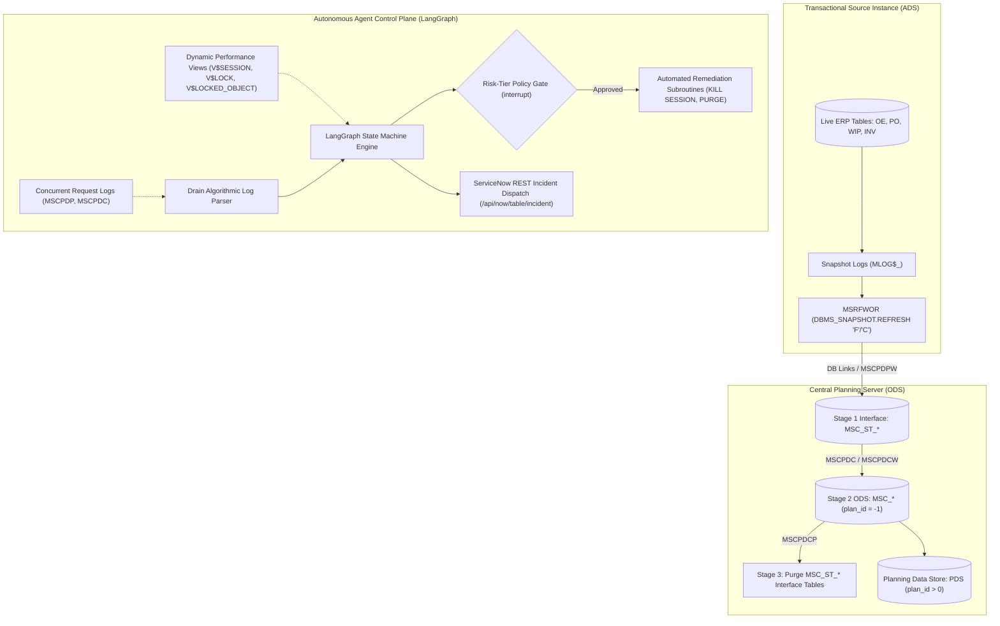
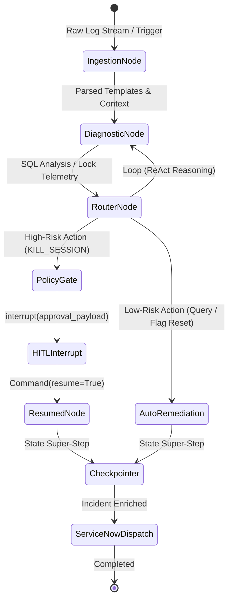
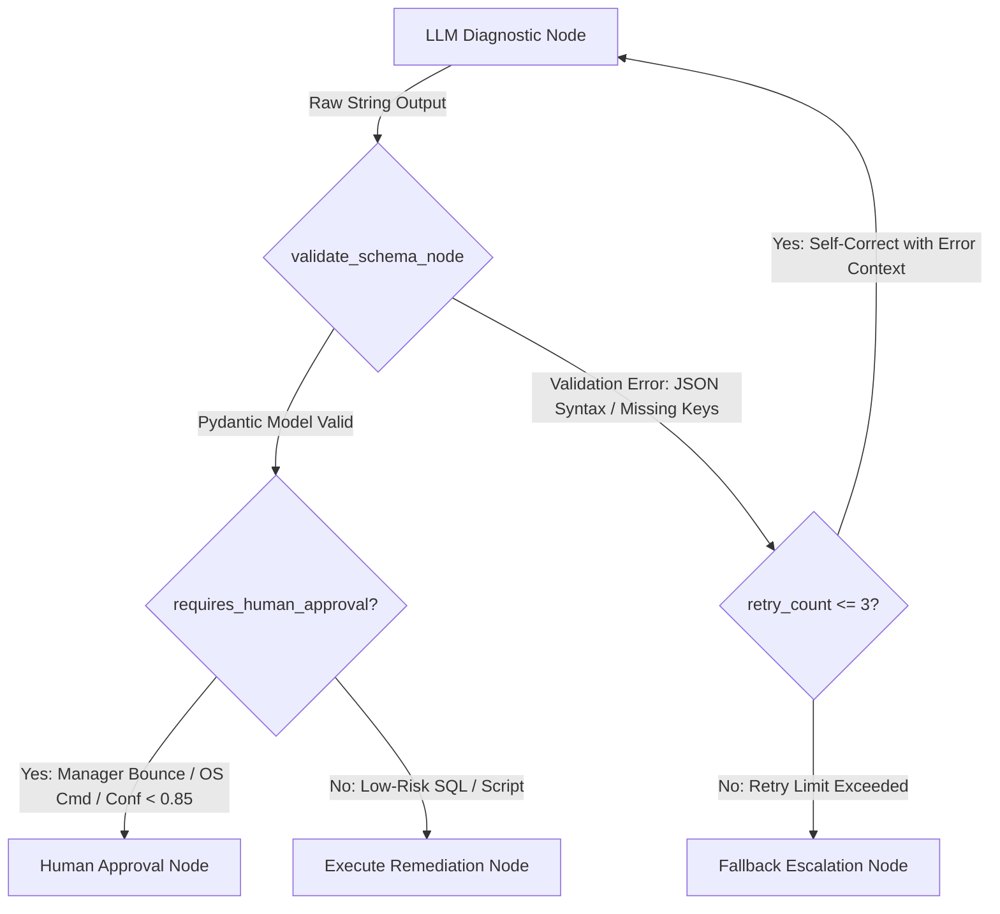

# Engineering Training & Study Guide
## Autonomous GenAI Diagnostic Agent Architecture for Oracle ASCP Collections

---

## Executive Summary & System Objectives
Oracle Advanced Supply Chain Planning (ASCP) orchestrates enterprise supply chains by decoupling computationally intensive planning solvers from transactional Enterprise Resource Planning (ERP) databases. 
This study guide outlines the complete technical blueprint, operational failure modes, Oracle database internals, and the stateful **LangGraph Control Plane** engineered to autonomously diagnose and heal collections pipelines.



---

## Section 1: ASCP Collection Pipeline Mechanics

### 1.1 Dual-Stage ETL Rationale
ASCP relies on snapshot-driven data pipelines to decouple computationally intensive optimization algorithms from live transactional engines (**Application Data Stores, or ADS**). 
Executing planning calculations directly against transactional databases degrades online transaction processing (OLTP) throughput and introduces computational divergence in Advanced Planning and Scheduling (APS) engines due to uncommitted transactional mutations. 

To establish an isolated operational boundary:
1. Transactional records are extracted into an **Operational Data Store (ODS)** on the central planning server, tagged with static identifier `plan_id = -1`.
2. ODS baseline data subsequently feeds the **Planning Data Store (PDS)** when active planning runs generate output models (`plan_id > 0`).

---

### 1.2 Stage 1: Planning Data Pull & Source Snapshot Refresh (MSCPDP / MSCPDPW)
The collection workflow is initiated when the parent concurrent program **Planning Data Pull (MSCPDP)** is triggered on the central planning server:

* **Source Snapshot Refresh (`MSRFWOR`)**:
  MSCPDP launches `MSRFWOR` on the source ERP instance, executing `DBMS_SNAPSHOT.REFRESH`:
  * **Fast Incremental Mode (`'F'`)**: Evaluates only net-change delta records captured in source snapshot logs (`MLOG$_`) since the previous collection run.
  * **Complete Mode (`'C'`)**: Fully re-evaluates and refreshes the entire transactional entity space.
* **Parallel Pull Worker Pool (`MSCPDPW`)**:
  Spawns up to **35 parallel workers** dynamically distributing tasks across entity categories (Demands, Supplies, Items, BOMs, Routings, Resources).
* **Inter-Process Communication (`DBMS_PIPE`)**:
  Parent-worker coordination is maintained via Oracle database pipes (`DBMS_PIPE`). The parent writes task messages; workers poll, extract data across database links, and return status codes.
  > [!WARNING]
  > **Pipe Buffer Failure Vector**: If a child worker crashes without returning an exit code, or if the pipe buffer fills, the parent process hangs indefinitely waiting on `pipe get`.
* **Staging Interface Ingestion (`MSC_ST_%`)**:
  Workers populate raw staging tables adhering to `MSC_ST_<ENTITY_NAME>` (e.g., `MSC_ST_DEMANDS`). Syntax and basic structural cleansing occur here, quarantining malformed rows.

---

### 1.3 Stage 2: Planning ODS Load & Global Surrogate Key Mapping (MSCPDC / MSCPDCW)
When all pull workers terminate successfully, the parent request set **Planning ODS Load (MSCPDC)** executes:

* **Parallel Load Workers (`MSCPDCW`)**:
  Allocates up to **25 parallel workers** handling transformation tasks across concurrent execution threads.
* **Global Surrogate Key Resolution**:
  In multi-source deployments, natural business keys (Item Number, Organization, Routing Step, Vendor Site) are translated into globally unique surrogate keys:
  $$\text{Global Surrogate ID} = f(\text{Source Business Key}, \text{instance\_id})$$
  Generated keys are reused across cycles to preserve relational integrity.
* **Validation & Error Tracking (`PROCESS_STATUS` / `ERR_CODE`)**:
  Staging rows undergo inline business rule validation inside `MSC_ST_%`:
  * `PROCESS_STATUS = 1`: Unprocessed
  * `PROCESS_STATUS = 2`: In-Process
  * `PROCESS_STATUS = 3`: Error / Quarantined
  * `PROCESS_STATUS = 4`: Validated / Complete
  Validated records (`PROCESS_STATUS = 4`) are inserted into core base ODS tables (`MSC_%`) tagged with `plan_id = -1`.
* **ODS Atomic Swap**:
  Before committing newly loaded operational datasets, ODS load workers purge obsolete records (`plan_id = -1`) from core `MSC_%` tables to prevent duplicates.

---

### 1.4 Stage 3: Purge Staging Tables (MSCPDCP)
The final phase executes **Planning Data Collection - Purge Staging Tables (MSCPDCP)**, issuing structural `TRUNCATE` operations across all `MSC_ST_%` interface tables.

> [!CAUTION]
> **Purge Cascade Failure**: If Stage 3 is skipped or aborts, legacy staging records persist. Subsequent collection runs append new extractions alongside stale rows, causing unique constraint collisions (`ORA-00001`) during surrogate key resolution in Stage 2.

#### Collection Stage Technical Summary
| Collection Stage | Parent Program | Sub-Processes & Workers | Source-to-Target Schemas | Primary Technical Objective |
|---|---|---|---|---|
| **Stage 1: Planning Data Pull** | `MSCPDP` | `MSRFWOR`, `MSCPDPW` (1–35 workers) | ADS (`MLOG$_` MVs) $\rightarrow$ `MSC_ST_%` via DB Links | Delta/Complete extraction from source MVs into interface staging tables over `DBMS_PIPE`. |
| **Stage 2: Planning ODS Load** | `MSCPDC` | `MSCPDCW` (1–25 workers) | `MSC_ST_%` $\rightarrow$ `MSC_%` (`plan_id = -1`) | Business key translation, global surrogate ID generation, row validation, and core ODS population. |
| **Stage 3: Purge Staging** | `MSCPDCP` | `MSCPDCP` process | `MSC_ST_%` (Cleansed / Truncated) | Truncate interface tables to prevent surrogate key collisions and lock contention on future runs. |

---

## Section 2: Technical Failure Modes & Oracle Lock Resolution

### 2.1 Enqueue Lock Modes (`V$LOCKED_OBJECT.LOCKED_MODE`)
DML and DDL operations acquire DML enqueue locks (TM-type locks) to preserve schema stability.

```
0 - NONE      : Lock requested but not yet granted
1 - NULL      : Concurrent access placeholder
2 - ROWS_S    : Row Share (SS)
3 - ROW_X     : Row Exclusive (SX) - Standard DML (INSERT, UPDATE, DELETE)
4 - SHARE     : Share Table Lock (S)
5 - S/ROW-X   : Share Row Exclusive (SSX)
6 - EXCLUSIVE : Exclusive Table Lock (X) - DDL (TRUNCATE, ALTER TABLE, LOCK TABLE EXCLUSIVE)
```

#### TM Mode 6 Operational Impact
A Mode 6 Exclusive lock grants absolute control over an object, blocking all concurrent DML (Mode 3) and DDL operations. Mode 6 is required when `MSCPDCP` executes `TRUNCATE TABLE MSC_ST_%` or when partition exchange operations are invoked. If an uncommitted session holds a Mode 3 lock, a Mode 6 request blocks or raises `ORA-00054`.

### 2.2 Operational Failure Modes
1. **`ORA-00054: resource busy and acquire with NOWAIT specified or timeout expired`**:
   Occurs when an exclusive Mode 6 request (such as `TRUNCATE TABLE MSC_ST_DEMANDS`) encounters an active Mode 2 or Mode 3 lock held by uncommitted DML.
2. **`ORA-14098: index mismatch in ALTER TABLE EXCHANGE PARTITION`**:
   Occurs during bulk partition swapping into core ODS tables (`MSC_%`) when index definitions, nullability, or column orders diverge between staging partitions and target base partitions.
3. **`ORA-00001: unique constraint violated during ODS Load`**:
   Caused by unpurged residual staging rows from a failed Stage 3 `MSCPDCP` run colliding during global surrogate key resolution.
4. **`ORA-12571: TNS:packet writer failure`**:
   Network dropped or timed out across database links during source snapshot refresh (`MSRFWOR`).
5. **`ORA-02478: maxextents reached for segment`**:
   Tablespace segment exhaustion combined with worker aborts causing `DBMS_PIPE` deadlock.

---

### 2.3 Diagnostic SQL Queries

#### Active Lock Identification
```sql
SELECT 
    lo.session_id AS sid,
    s.serial#,
    s.username AS oracle_username,
    s.osuser AS os_user_name,
    s.process AS os_process_id,
    o.owner AS object_owner,
    o.object_name,
    o.object_type,
    lo.locked_mode,
    CASE lo.locked_mode
        WHEN 0 THEN 'NONE'
        WHEN 1 THEN 'NULL'
        WHEN 2 THEN 'ROW SHARE (SS)'
        WHEN 3 THEN 'ROW EXCLUSIVE (SX)'
        WHEN 4 THEN 'SHARE (S)'
        WHEN 5 THEN 'SHARE ROW EXCLUSIVE (SSX)'
        WHEN 6 THEN 'EXCLUSIVE (X)'
    END AS lock_mode_desc,
    s.status AS session_status,
    s.sql_id,
    sq.sql_text
FROM v$locked_object lo
JOIN dba_objects o ON lo.object_id = o.object_id
JOIN v$session s ON lo.session_id = s.sid
LEFT JOIN v$sql sq ON s.sql_id = sq.sql_id
WHERE o.object_name LIKE 'MSC%'
ORDER BY lo.session_id, o.object_name;
```

#### Hierarchical Root-Blocker Lock Tree (`CONNECT BY PRIOR`)
```sql
SELECT 
    LPAD(' ', (LEVEL - 1) * 2) || s.sid AS session_tree,
    s.sid,
    s.serial#,
    s.blocking_session,
    s.username,
    s.osuser,
    s.program,
    s.event,
    s.seconds_in_wait,
    s.sql_id,
    lo.locked_mode,
    o.object_name
FROM v$session s
LEFT JOIN v$locked_object lo ON s.sid = lo.session_id
LEFT JOIN dba_objects o ON lo.object_id = o.object_id
WHERE s.blocking_session IS NOT NULL 
   OR s.sid IN (SELECT blocking_session FROM v$session WHERE blocking_session IS NOT NULL)
START WITH s.blocking_session IS NULL 
       AND s.sid IN (SELECT blocking_session FROM v$session WHERE blocking_session IS NOT NULL)
CONNECT BY PRIOR s.sid = s.blocking_session;
```

---

## Section 3: Stateful LangGraph Agent Control Plane



### 3.1 State Schema & Reducer Mechanics
In LangGraph, state updates overwrite dictionary values by default. For multi-turn reasoning and telemetry accumulation, fields must be annotated with explicit reducers:

```python
from typing import Annotated, TypedDict, List, Dict, Any, Optional
from langchain_core.messages import AnyMessage
from langgraph.graph.message import add_messages
import operator

class DiagnosticContext(TypedDict):
    concurrent_request_id: int
    failed_phase: str              # 'PULL', 'LOAD', 'PURGE'
    target_staging_table: str
    detected_errors: List[str]
    lock_hierarchy: List[Dict[str, Any]]
    remediation_action: Optional[str]

class AgentState(TypedDict):
    # Accumulator reducer prevents context erasure across multi-turn graph iterations
    messages: Annotated[List[AnyMessage], add_messages]
    context: DiagnosticContext
    risk_level: str                 # 'LOW', 'MEDIUM', 'HIGH'
    is_remediated: bool
```

### 3.2 Drain Log Parsing Tree Algorithm
Unstructured concurrent request logs are tokenized into templates in $O(1)$ time per line:
* **Tree Depth Bounding**: Fixed depth bounds prefix traversal.
* **Internal Nodes**: Token precursors (`Phase`, `Worker`, `ORA-`).
* **Leaf Nodes**: Dynamic templates (e.g., `Planning Data Pull Worker <*> failed with code <*>`).
* **Parameter Vectors**: Extracted runtime variables (`{"TIMESTAMP": "...", "TARGET_OBJECT": "MSC_ST_DEMANDS"}`).

### 3.3 Dynamic Routing: `Command` & `Send` Primitives
* **`Command`**: Combines state mutations and dynamic destination routing:
  ```python
  return Command(update={"context": updated_ctx}, goto="remediation_node")
  ```
* **`Send`**: Enables parallel map-reduce fan-out across multiple database instances or blocked sessions:
  ```python
  return [Send("kill_worker", {"sid": 412}), Send("kill_worker", {"sid": 528})]
  ```

### 3.4 State Persistence & Checkpointing
* **`PostgresSaver` / `MemorySaver`**: Persists snapshots at super-step boundaries.
* **Thread Identifiers (`thread_id`)**: Indexed by Concurrent Request ID (`thread_id="REQ_890412"`).
* **Time-Travel**: `app.get_state_history(config)` permits debugging past execution frames.

### 3.5 Risk-Tiered HITL Governance
| Risk Tier | Target Action Type | Gate Mechanism | Execution Mode |
|---|---|---|---|
| **LOW** | Dynamic view querying (`V$LOCKED_OBJECT`, `V$SESSION`) | Automated Execution | Direct execution without approval |
| **MEDIUM** | Staging table statistics, status flag resets (`ST_STATUS`) | Conditional Interrupt | Auto-runs if dry-run passes |
| **HIGH** | `ALTER SYSTEM KILL SESSION`, `TRUNCATE TABLE` | Mandatory HITL Gate (`interrupt()`) | Graph halts; requires operator sign-off |

> [!IMPORTANT]
> **Idempotency Rule for HITL**:
> When `Command(resume=value)` is issued, the runtime restarts the interrupted node from its beginning. All operations prior to `interrupt()` must be strictly idempotent to avoid duplicate mutations.

---

## Section 4: ITSM Automation & Operational Remediation

### 4.1 ServiceNow REST API Integration
Structured diagnostic payloads enrich incidents via `POST /api/now/table/incident`:
```json
{
  "short_description": "ASCP Collection Failure: LOAD phase on MSC_ST_DEMANDS",
  "impact": "2",
  "urgency": "2",
  "assignment_group": "Database Administrators",
  "description": "{\n  \"concurrent_request_id\": 890415,\n  \"failed_phase\": \"LOAD\",\n  \"target_table\": \"MSC_ST_DEMANDS\",\n  \"detected_errors\": [\"ORA-00054\"],\n  \"root_cause_analysis\": \"Root blocker SID 412 holds Mode 6 Exclusive lock.\",\n  \"lock_hierarchy_tree\": [...],\n  \"recommended_playbook\": \"KILL_SESSION\"\n}",
  "work_notes": "Automated GenAI Diagnostic Agent completed root-cause classification. Risk Tier: HIGH."
}
```

### 4.2 Automated Staging Table Lock Recovery Playbook
```python
def automated_staging_lock_recovery(dsn: str, request_id: int, target_table: str):
    """
    One-Click DBA Playbook: Clears blocking sessions, resets process status flags,
    and truncates residual staging interface tables.
    """
    with oracledb.connect(dsn=dsn) as conn:
        with conn.cursor() as cursor:
            # Step 1: Terminate Mode 6 blockers
            lock_sql = """
                SELECT s.sid, s.serial# 
                FROM v$locked_object lo 
                JOIN dba_objects o ON lo.object_id = o.object_id 
                JOIN v$session s ON lo.session_id = s.sid 
                WHERE o.object_name = :tbl AND lo.locked_mode = 6
            """
            cursor.execute(lock_sql, tbl=target_table)
            for sid, serial in cursor.fetchall():
                cursor.execute(f"ALTER SYSTEM KILL SESSION '{sid},{serial}' IMMEDIATE")
            
            # Step 2: Reset processing status flags in staging interface
            reset_sql = f"""
                UPDATE {target_table} 
                SET process_status = 1, err_code = NULL 
                WHERE process_status = 2
            """
            cursor.execute(reset_sql)
            
            # Step 3: Issue safe truncation if legacy unpurged records persist
            truncate_sql = f"TRUNCATE TABLE {target_table}"
            cursor.execute(truncate_sql)
            conn.commit()
```

---

## Section 5: Practical Engineering Review Questions

### Q1: During a Stage 1 Planning Data Pull (`MSCPDP`), the parent process hangs indefinitely while worker processes (`MSCPDPW`) remain active in `V$SESSION` with event `pipe get`. What architectural mechanism manages communication between the parent and workers, what is the failure mode, and how do you diagnose it?
**Answer:**
Inter-process communication between `MSCPDP` and `MSCPDPW` is managed by Oracle database pipes (`DBMS_PIPE`). The hanging parent occurs due to pipe message drops, worker crashes, or buffer exhaustion, leaving the parent waiting for a completion signal that will never arrive. 
To diagnose:
1. Query `V$DB_PIPES` to verify active pipe allocations and buffer status.
2. Inspect worker wait events in `V$SESSION` (specifically `pipe get` or `pipe put`).
3. Check concurrent worker trace files for unhandled fatal crashes.
Remediation requires clearing orphan worker sessions via OS PID / `ALTER SYSTEM KILL SESSION` and purging the pipe buffer using `DBMS_PIPE.PURGE('MSC_PIPE_<instance_id>')`.

---

### Q2: Explain the technical operational failure that occurs if Stage 3 Purge Staging Tables (`MSCPDCP`) fails to run, and a complete collection is triggered subsequently.
**Answer:**
If `MSCPDCP` fails or is omitted, legacy unpurged records remain in `MSC_ST_%` interface tables. When a subsequent collection runs, Stage 1 pull workers append newly extracted operational rows alongside residual rows.
During Stage 2 ODS Load (`MSCPDC`), surrogate key assignment routines evaluate natural business keys to generate planning surrogates:
$$\text{Global Surrogate ID} = f(\text{Source Business Key}, \text{instance\_id})$$
Duplicate natural keys across stale and newly extracted rows violate unique constraints on surrogate mapping structures (`MSC_MAPPING_CLAUSES`), triggering `ORA-00001: unique constraint violated` and halting Stage 2.

---

### Q3: An automated DBA script attempts to execute `TRUNCATE TABLE MSC_ST_DEMANDS` during recovery but fails instantly with `ORA-00054`. Explain the underlying lock enqueue mechanics causing this error.
**Answer:**
`TRUNCATE` is a DDL statement requiring an **Exclusive Table Lock (TM Mode 6)** on the target table. `ORA-00054: resource busy and acquire with NOWAIT specified` occurs because another active session holds an uncommitted DML lock—typically **Row Exclusive (TM Mode 3)**—on `MSC_ST_DEMANDS`.
Because Mode 6 is mutually exclusive with all other lock modes (Modes 2 through 6), Oracle immediately raises `ORA-00054` when `NOWAIT` is specified, or when the acquire timeout expires before the blocking session commits or terminates.

---

### Q4: In LangGraph, why must message lists in a state schema be defined with `Annotated[list[AnyMessage], add_messages]` instead of a standard `list[AnyMessage]` definition?
**Answer:**
In LangGraph, node return dictionaries overwrite existing dictionary values in state by default. If `messages` is declared as a standard `list[AnyMessage]`, each node that returns a message replaces the entire list, resulting in immediate loss of previous conversation history and reasoning traces.
Using `Annotated[list[AnyMessage], add_messages]` attaches an accumulator reducer function (`add_messages`) that appends incoming messages to the existing list, maintaining conversation continuity across multi-turn reasoning steps.

---

### Q5: Why must node code preceding an `interrupt()` call in LangGraph be strictly idempotent?
**Answer:**
When a LangGraph graph resumes from an `interrupt()` gate via `Command(resume=value)`, the runtime re-executes the target node from its starting line.
If code preceding `interrupt()` executes non-idempotent side effects (such as sending an external notification, charging a credit card, or inserting a log record), those actions will execute a second time upon resumption. Ensuring all operations prior to `interrupt()` are idempotent prevents duplicate side effects when the graph resumes.

---

## Section 6: 6-Layer Structural Prompt Stratification & Self-Healing Validation Loop

### 6.1 Mathematical Formulation of the Stratified Prompt Architecture
To eliminate reasoning drift and hallucination across unsupervised runs, prompts are decomposed into six orthogonal functional layers:

$$\text{Prompt} = \mathcal{P}_{\text{Role}} + \mathcal{C}_{\text{Domain}} + \mathcal{I}_{\text{Task}} + \mathcal{D}_{\text{Context}} + \mathcal{S}_{\text{Schema}} + \mathcal{K}_{\text{Constraints}}$$

```
+---------------------------------------------------------------------------------------------------+
|  1. P_Role: Expert Persona & Operational Boundaries (Lead Oracle ASCP Diagnostic Engine)         |
+---------------------------------------------------------------------------------------------------+
|  2. C_Domain: Pipeline Topology, Tables (MSC_ST_*), Errors (MSC_ERRORS), Scripts (cmclean.sql)    |
+---------------------------------------------------------------------------------------------------+
|  3. I_Task: Analytical Step Sequence & Weighted Diagnostic Confidence Calculation (C_diag)        |
+---------------------------------------------------------------------------------------------------+
|  4. S_Schema: Strict Machine-Parseable Typed JSON Schema Contract                                |
+---------------------------------------------------------------------------------------------------+
|  5. K_Constraints: Format Rules (No prose, zero markdown code fences ```json ... ```)             |
+---------------------------------------------------------------------------------------------------+
|  6. D_Context: Dynamic Runtime Payload (Drain Templates, Session Hierarchy, Wait Events)        |
+---------------------------------------------------------------------------------------------------+
```

#### Diagnostic Confidence Weighted Model
$$C_{\text{diag}} = 0.4 \cdot S_{\text{error\_code}} + 0.4 \cdot S_{\text{trace\_match}} + 0.2 \cdot S_{\text{state\_consistency}}$$

* $S_{\text{error\_code}} \in [0, 1]$: Certainty of the primary Oracle error signature (`ORA-00054`, `ORA-14098`, `ORA-00001`).
* $S_{\text{trace\_match}} \in [0, 1]$: Drain log template alignment against known failure catalogs.
* $S_{\text{state\_consistency}} \in [0, 1]$: Corroboration between database performance views (`V$SESSION`, `V$LOCKED_OBJECT`) and log timestamps.

---

### 6.2 Self-Healing Schema Validation Loop in LangGraph



```python
def validate_schema_node(state: AgentDiagnosticState) -> Dict[str, Any]:
    raw_output = state["raw_llm_output"]
    try:
        validated = DiagnosticReport.model_validate_json(raw_output)
        requires_approval = (
            validated.requires_manager_bounce or 
            any(r.action_type == "OS" for r in validated.remediations) or
            validated.diagnostic_summary.confidence_score < 0.85
        )
        return {
            "parsed_diagnosis": validated.model_dump(),
            "is_validated": True,
            "requires_human_approval": requires_approval
        }
    except Exception as err:
        return {
            "is_validated": False,
            "retry_count": state["retry_count"] + 1,
            "validation_error": str(err)
        }

def check_validation_routing(state: AgentDiagnosticState) -> str:
    if state["is_validated"]:
        if state["requires_human_approval"]:
            return "human_approval_node"
        return "execute_remediation_node"
    if state["retry_count"] > 3:
        return "fallback_escalation_node"
    return "llm_diagnostic_node"
```

